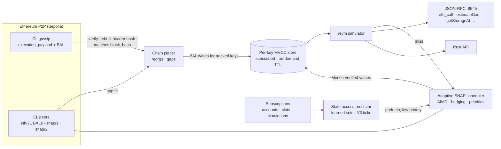

<p align="center">
  
</p>

<p align="center">
  <a href="#quick-start"></a>
  <a href="#"></a>
  <a href="rust-toolchain.toml"></a>
  <a href="#license"></a>
</p>

<p align="center"><b>Not every app needs a full node. Sync (and archive) only what you need.</b></p>

<p align="center">
  
</p>

<p align="center">
  
  <br><sub>Real recording, real Sepolia: skim follows the chain from P2P gossip, and unmodified viem gets Uniswap V3/V4 state, quotes and logs from it. (<a href="assets/demo.mp4">MP4</a> · <a href="assets/demo.tape">how it was recorded</a>)</sub>
</p>

**skim** is an application-specific Ethereum state client. You declare the state your app cares about: accounts, storage slots, or whole simulations. skim keeps exactly that state current, straight from the Ethereum P2P network, and runs your `eth_call`s locally against it in milliseconds. Anything else is fetched on demand, with Merkle proofs verified, only when a request needs it.

There is no full node, no RPC provider, and no block re-execution. The state follows the chain through Glamsterdam's [block-level access lists](https://eips.ethereum.org/EIPS/eip-7928) (BALs).

```console
$ skim run --config skim.yaml          # follows Sepolia, serves JSON-RPC on :8545
$ cast call 0xfFf9…6B14 "balanceOf(address)(uint256)" 0x3289…EfF1 --rpc-url http://127.0.0.1:8545
101838818991837710804 [1.018e20]       # unmodified Foundry, viem, ethers
```

---

## Why this is possible now

Until Glamsterdam, knowing the latest state meant executing every block, or asking a node that did. [EIP-7928](https://eips.ethereum.org/EIPS/eip-7928) changes that. Every block now commits to a **block access list**: every account and slot it touched, with the **post-values** it wrote. With ePBS, that list travels in the execution payload gossiped on the consensus layer.

skim builds on that:

| | How skim gets it |
|---|---|
| **New blocks + their state diffs** | CL `execution_payload` gossip. The EL header is rebuilt from the payload, so the BAL is bound to the block hash. eth/71 BAL requests fill gaps. |
| **State it has never seen** | snap/1 + snap/2 point lookups at the parent root, **verified against the state root with Merkle proofs**, then brought to the head by replaying the BAL |
| **Execution** | revm with Amsterdam rules over a per-key MVCC store |

## The model: subscribed state, on-demand everything else

| | **Subscribed** (your state watchlist) | **On demand** |
|---|---|---|
| What | Accounts, slots and simulations you declare | Everything else |
| Freshness | Applied from every block's BAL | Fetched for the requested block; cached for a TTL |
| Hot path | No network. Target: a few ms | One verified fetch wave, then local |
| Guarantee | **Ready** = head BAL applied **and** every required key known. Otherwise reported as not ready. | Best effort, and never wrong: unknown state is never treated as zero |

```yaml
# skim.yaml (see skim.example.yaml)
state:
  subscriptions:
    - name: weth-usdc-0.3%
      address: "0x6Ce0896eAE6D4BD668fDe41BB784548fb8F59b50"
      account: true
      storage: ["0x0", "0x4"]            # slot0, liquidity
    - name: my-quoter                     # a simulation you run every block
      calls:
        - to: "0xEd1f6473345F45b75F8179591dd5bA1888cf2FB3"
          data: "0xc6a5026a…"
      on_block: true                      # re-run each block; read via skim_subscriptionStatus
      retention: { mode: archive }        # keep every version on disk (skim run --archive <path>)
  on_demand: { enabled: true, cache_ttl_blocks: 4 }
  limits:    { max_subscribed_keys: 100000 }
```

Simulation subscriptions don't need you to know storage layouts. skim learns each call's access set, and protocol-aware predictors cover it too: for Uniswap V3, the tick range a swap of a given size can reach. Those keys stay warm.

## What we measured

All numbers are from Sepolia, measured from one home connection over public peers. Details and caveats are in the [experiment logs](docs/README.md#experiment-logs).

| | Result |
|---|---|
| **Correctness** | Every completed run matched a reference archive node byte for byte at the same block hash. Totals: 1,753 calls in a 1-hour soak; 2,700 calls with randomized, never-seen Uniswap V3 quotes; 866 with proof verification on; 36/36 JSON-RPC requests ([P0](docs/experiments/m2-p0-miss-tail.md), [verified state](docs/experiments/m2-verified-state.md)). |
| **State ready after a new block** | BAL applied **0.16 ms** after the payload arrives. State ready at about **880 ms** P50 after slot start, bounded by gossip arrival ([M1](docs/experiments/m1-follower.md)). |
| **Warm simulation** | Uniswap V3 quote over JSON-RPC: **0.25 ms** P50, 0.56 ms P99; ~8,500 calls/s at 50 in flight |
| **Fetch reliability** | 298,084 SNAP jobs over public peers, **0 failed**, 126 disconnects absorbed ([soak](docs/experiments/m0-soak.md)) |
| **Unseen inputs** | Background prefetch had **99.9%** of predicted keys ready at call time. Worst on-path fetch: 1.6 s ([P1](docs/experiments/m2-p0-miss-tail.md)). |
| **Footprint** | ~200 MB RSS with the default 256-block window (~100 MB with `--window 32`), ~0.25 CPU core. On disk: a restart snapshot of subscribed state (~1 MB for 2,400 keys; `--ephemeral` for none) |

What skim is **not**: faster than an in-process full node on raw execution, or a trustless light client (yet). It saves *resources* while keeping simulation quality close to a node's. Part of the saving is work that public SNAP peers do on skim's behalf.

## Architecture



| Crate | Role |
|---|---|
| `skim-bal` | EIP-7928 decoding, commitment checks, per-key normalization |
| `skim-cl` | Minimal Gloas gossip listener: discv5, libp2p, envelope parsing, payload verification |
| `skim-el` | EL networking on reth: eth/71 BALs, snap/2 and a snap/1 client, head following |
| `skim-snap` | Adaptive request scheduler and SNAP Merkle-proof verification |
| `skim-state` | Per-key MVCC store (BAL application, base inserts with replay, reorg rollback, retention) and the selective on-disk archive |
| `skim-sim` | revm over snapshots, state access predictor, subscriptions |
| `skim-cli` | `skim run` (JSON-RPC), `skim follow`, probes and benchmarks |

## Quick start

```bash
git clone https://github.com/leekt/skim && cd skim
cargo build --release                     # Rust 1.97 (pinned in rust-toolchain.toml)
./target/release/skim run --config examples/uniswap-v3/skim.yaml
```

Wait for `state ready` in the log. Then point any Ethereum tooling at `http://127.0.0.1:8545`:

```js
import { createPublicClient, http, parseAbi, parseEther } from 'viem'
import { sepolia } from 'viem/chains'

const client = createPublicClient({ chain: sepolia, transport: http('http://127.0.0.1:8545') })
const { result } = await client.simulateContract({
  address: '0xEd1f6473345F45b75F8179591dd5bA1888cf2FB3',          // Uniswap V3 QuoterV2
  abi: parseAbi(['function quoteExactInputSingle((address,address,uint256,uint24,uint160)) returns (uint256,uint160,uint32,uint256)']),
  functionName: 'quoteExactInputSingle',
  args: [['0xfFf9976782d46CC05630D1f6eBAb18b2324d6B14', '0x1c7D4B196Cb0C7B01d743Fbc6116a902379C7238', parseEther('1'), 3000, 0n]],
})
// answered locally in a few ms
```

**Next steps:**
- **[Examples](examples):** Uniswap V3, Uniswap V4 and sending transactions, all with viem.
- **[Docs](docs):** [getting started](docs/guide/getting-started.md), [how it works](docs/guide/how-it-works.md), [configuration](docs/guide/configuration.md), [JSON-RPC](docs/guide/json-rpc.md), [archive](docs/guide/archive.md), [trust](docs/guide/trust-and-correctness.md), [troubleshooting](docs/guide/troubleshooting.md).

**Supported methods:**
- State and simulation: `eth_call` (with state overrides), `eth_simulateV1`, `debug_traceCall` / `debug_traceTransaction` / `debug_traceBlockBy*` (default, `callTracer`, `prestateTracer`, `4byteTracer`, `muxTracer`), `eth_createAccessList`, `eth_getProof`, `eth_estimateGas`, `eth_getBalance`, `eth_getCode`, `eth_getStorageAt`, `eth_getTransactionCount` (including `pending`)
- Transactions: `eth_sendRawTransaction` (gossiped straight to EL peers), `eth_getTransactionByHash`, `eth_getTransactionReceipt`
- Logs: `eth_getLogs`. Receipts are fetched only for blocks whose bloom and BAL match, and checked against `receiptsRoot`.
- Blocks and chain: `eth_getBlockByNumber` / `eth_getBlockByHash` (full transactions), `eth_getBlockReceipts`, `eth_feeHistory`, `eth_blockNumber`, `eth_chainId`, `net_version`, `eth_syncing`, `eth_gasPrice`, `eth_maxPriorityFeePerGas`, `web3_clientVersion`
- `skim_subscriptionStatus`, `skim_status`
- WebSocket on the same port: `eth_subscribe` for `newHeads`, `logs` and `skim_subscriptions`

**Errors:**
- Out-of-scope methods (`eth_sendTransaction`, since skim holds no keys, and filters and subscriptions) return `-32004`.
- State or blocks skim can't serve return `-32002`. skim never returns a fabricated value.

## Correctness rules skim lives by

- **Unknown is never zero.** A value is used only if it was written by a BAL, or fetched and verified.
- **A SNAP answer must prove itself.** Accounts are checked against the state root, slots against the verified storage root. A slot is zero only when *proven*: absent account, empty trie, or an exclusion proof. Anything else is "unavailable" and gets retried elsewhere.
- **Fetch at the parent, replay to the head.** At gossip time peers usually haven't executed the new block yet. skim reads at root(H−1) and applies BAL(H) itself.
- **Reorgs roll back only to the common ancestor**, using the EL chain, and replay from there.

## Trust model

| Checked | Not (yet) checked |
|---|---|
| BAL ↔ block hash (header rebuilt from the payload), block hash ↔ builder bid | Proof-of-stake fork choice and finality, BLS signatures |
| Every SNAP value ↔ the block's state root (Merkle proofs) | Execution correctness of the block itself |
| Header parent links, code hashes | |

Consensus light-client verification is on the roadmap. Until then, skim trusts the gossiped head the way an optimistic client does.

## Status and roadmap

- [x] M0: P2P feasibility (CL payload gossip, eth/71, snap/1+2, adaptive scheduler)
- [x] M1: BAL state follower with MVCC store
- [x] M2: simulator, JSON-RPC adapter, verified state, state access predictor
- [x] M3: subscriptions (subscribed vs on-demand state)
- [ ] Resource benchmark vs a Nethermind full node (same workload, same block hashes)
- [x] **M4: selective state archiving.** `retention: archive` keeps every BAL-written version of subscribed state on disk. `eth_getStorageAt` and `eth_call` then work at historical blocks for what you subscribed to, from the block each key became known (90/90 and 51/51 historical reads matched a reference archive node, restart gaps healed from eth/71; see [M4](docs/experiments/m4-archive.md)). *Sync and archive only what you need.*
- [x] **M4.2: backfill from retained BALs.** `--archive-backfill N` extends archived history up to about 2 weeks before a subscription existed. Unchanged keys are covered for the whole range; written keys are covered from their first write. Live: 102 historical reads matched a reference archive node, 3 were correctly refused, 0 were wrong.
- [x] **M5:** generalized learned patterns (exact args + amount buckets) with key/byte bounds. The V3 predictor is configurable in `skim run`: calls that needed the network fell from 51 to 19 out of 400. Added `eth_sendRawTransaction`, receipts and `eth_getLogs`, all identical to a reference node in every check ([M5](docs/experiments/m5-predictors-and-chain-data.md)).
- [x] `storage: all`: a contract's whole storage, downloaded and verified against its storage root, then kept current from BALs (Uniswap V3 pool: 3,677 slots; 29/29 sampled slots identical to a reference node). WebSocket JSON-RPC: `newHeads`, `logs`, and `skim_subscriptions` pushes with every block's `on_block` results
- [x] **M6: correctness and bounds.** Review fixes with regression tests. 2 h chaos soak (kills, restarts, key-set switches): 3,465 matches, 23 refusals, 0 wrong. Verified restart snapshots, warm `eth_call` 3× faster ([M6](docs/experiments/m6-correctness-and-bounds.md))
- [x] Serving the network: recent headers, bodies, receipts and BALs (eth/69–71, snap/2), bytecode, and payload envelopes by range/root (consensus), each re-checked against its header before it is sent ([M6](docs/experiments/m6-correctness-and-bounds.md#serving-the-network))
- [ ] Consensus light-client verification: implemented and unit-tested, waiting on consensus clients to serve Gloas light-client data
- [ ] Mainnet once Glamsterdam ships there

Design: [PROJECT.md](PROJECT.md). Guides and experiment logs: [docs/](docs).

## License

Licensed under either of [Apache License 2.0](LICENSE-APACHE) or [MIT](LICENSE-MIT), at your option.
