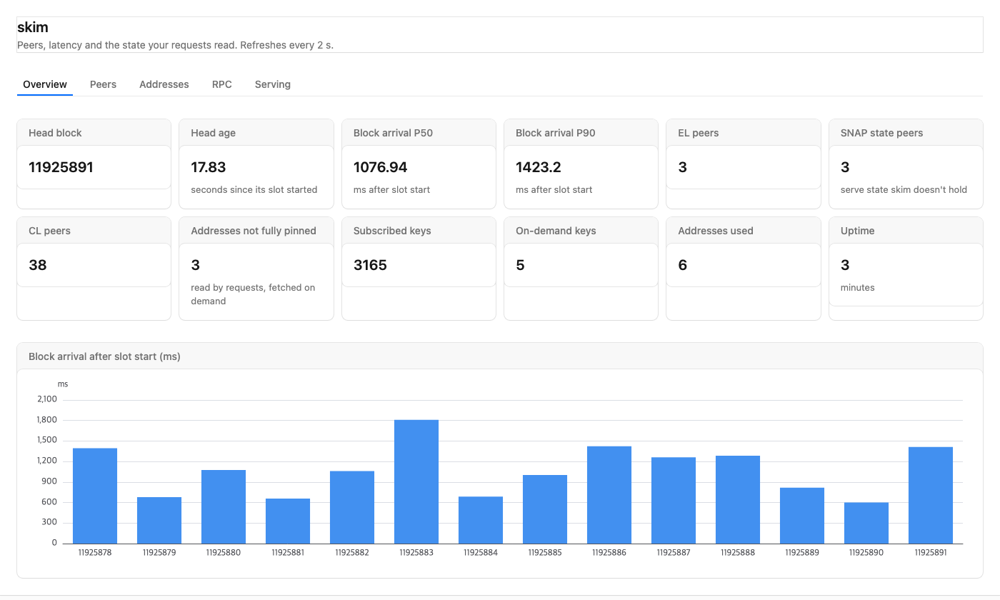

# skim dashboard

`skim run` serves this page at **http://127.0.0.1:8545/dashboard** (the `--rpc` address). It polls `skim_dashboard` every 2 s.



| Tab | Shows |
|---|---|
| Overview | head, block arrival after slot start (chart, P50/P90), peer counts, pinned vs on-demand state |
| Peers | EL and CL clients by kind; per EL peer: protocol, SNAP support, SNAP latency (EWMA and best), answers, errors; per CL peer: agent, direction, gossip delivered first, head slot |
| Addresses | every address `eth_call` executions read: calls, slots, how much is pinned by a subscription, keys fetched from the network, and a ready-to-paste `skim.yaml` block for hot unpinned ones |
| RPC | calls, errors, P50/P95/max latency per method |
| Serving | what skim answered for other peers |

## How it is built
The page is plain [Kumo](https://www.npmjs.com/package/@cloudflare/kumo): stock components and Kumo's standalone CSS, no custom styles.

**The layout is configuration.** `src/dashboard.json` is a Kumo catalog `UITree`: elements of Kumo component types, with props bound to the `skim_dashboard` result by `{ "path": "/…" }` and `visible` conditions.

**The renderer is generic.** `src/render.jsx`:
- maps element types to Kumo components
- resolves paths and visibility with `@cloudflare/kumo/catalog`
- adds one thing, `repeat: { path }`, for table rows

**Charts** are ECharts option objects in the config, drawn by Kumo's `Chart`.

**Editing the config:** edit `scripts/gen-config.py` (it writes `src/dashboard.json`; flat trees are verbose by hand), or edit the JSON directly.

## Build
```sh
cd dashboard
npm install
npm run build        # writes crates/skim-cli/assets/dashboard.html.gz, embedded in the skim binary
```

**Live development:** `npm run dev` serves the page at http://localhost:5173 and proxies `/rpc` to a skim on 127.0.0.1:8545.
