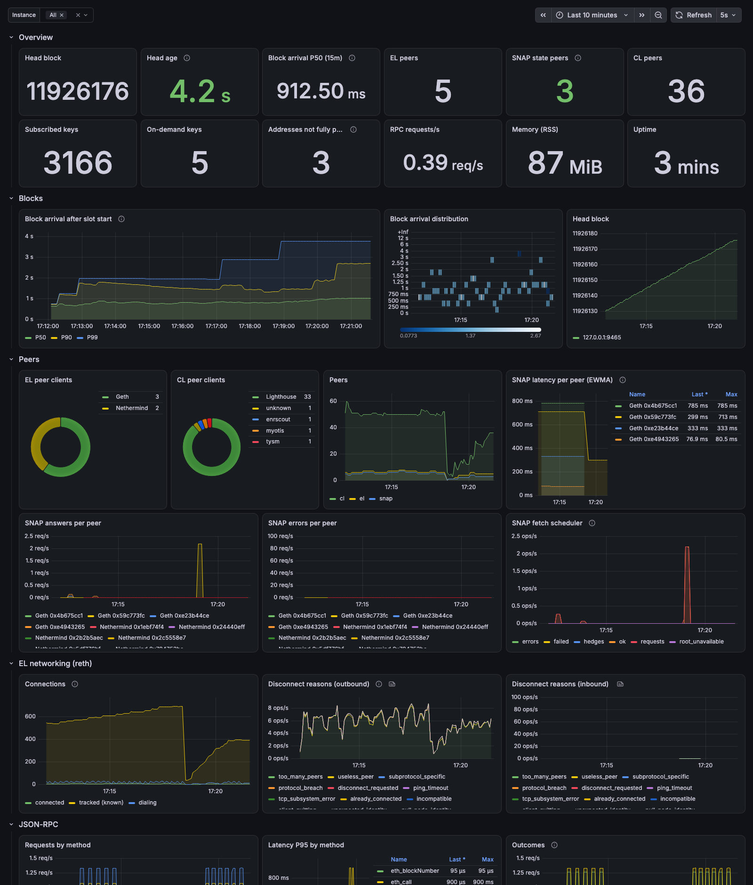

# Monitoring skim with Prometheus and Grafana



## Run it
1. Start skim with metrics on:
   ```bash
   skim run --config skim.yaml --metrics 127.0.0.1:9465
   ```
2. Start Prometheus and Grafana:
   ```bash
   docker compose -f metrics/docker-compose.yaml up -d
   ```
3. Open Grafana on port **3001**. The **skim** dashboard is the home page, and anonymous viewing is on (admin login: `admin` / `admin`). Prometheus is on port **9091**.

**Docker on Linux:** containers reach the host at the docker bridge address, not loopback. Start skim with `--metrics 0.0.0.0:9465` (keep the port firewalled), or set `SKIM_METRICS_TARGETS` to an address skim listens on.

## Settings
**skim flags:**

| Flag | Default | |
|---|---|---|
| `--metrics <addr>` | off | serve `/metrics` on this address |
| `--metrics-addresses <n>` | `50` | how many of the most-called addresses get per-address series (`0` = none) |
| `--metrics-idle <s>` | `300` | drop series not updated for this long (peers that left, addresses that fell out of the top) |

**Stack** (environment variables, or a `metrics/.env` file):

| Variable | Default | |
|---|---|---|
| `SKIM_METRICS_TARGETS` | `host.docker.internal:9465` | comma-separated `host:port` list to scrape; several skim nodes show up as instances |
| `SCRAPE_INTERVAL` | `5s` | |
| `PROMETHEUS_PORT` / `PROMETHEUS_RETENTION` | `9091` / `15d` | |
| `GRAFANA_PORT` / `GRAFANA_ADMIN_PASSWORD` | `3001` / `admin` | |
| `GRAFANA_ANONYMOUS` | `true` | view dashboards without logging in |

## The dashboard
`provisioning/grafana/dashboards/skim.json` is generated by `gen_dashboard.py`. Edit the script and re-run it, or edit the dashboard in Grafana and export it over the file. An **Instance** selector at the top picks which nodes to show.

| Row | Panels |
|---|---|
| Peer acquisition | time to the first SNAP peer, SNAP peers seen and held (≥ 60 s), sessions by client, session ends by reason |
| Overview | head block and its age, block arrival P50, EL / SNAP / CL peers, subscribed and on-demand keys, RSS, uptime |
| Blocks | arrival after slot start (P50/P90/P99 and a heatmap), head block |
| Peers | EL and CL clients, peer counts, SNAP latency / answers / errors per peer, fetch-scheduler events |
| EL networking (reth) | connections, known peers, disconnect reasons (e.g. remote `too_many_peers`) |
| JSON-RPC | request rate, P95 latency and outcomes per method, plus a method table |
| State and addresses | the addresses your calls read (pinned / partly pinned / on demand, keys fetched), call and fetch rates per address, store size, subscription readiness |
| Serving the network | requests skim answered for other peers, and items sent |
| Process | CPU, RSS, file descriptors, threads, estimated retained data and entries by structure |

The process row's "Retained data by structure (stacked) vs RSS" compares payload estimates with RSS; "Entries by structure" shows occupancy. `skim_status.memory.parts` exposes the same `part`, `entries`, `bytes` and `capacity` records. Some capacities are actual collection capacities, others limits or current counts; peer-buffer bytes are not measured. The gap to RSS also includes database caches, other uninstrumented allocations, allocator overhead and resident code pages. See [memory and latency](../docs/guide/memory-and-latency.md).

## Alerts
`provisioning/grafana/alerting/skim-alerts.yaml` provisions four rules. They show in Grafana under **Alerting**; add a contact point there (Slack, email, …) to be notified.

| Alert | Fires when |
|---|---|
| No SNAP state peers | 0 SNAP peers for 5 min: state skim doesn't hold can't be fetched |
| Head behind | the head is over 36 s old for 2 min (3 Sepolia slots), or the node stopped reporting |
| Subscription not ready | a subscription isn't ready for 5 min |
| Requests refused | over 10% of requests answered `-32002` for 10 min |

For a ready-to-paste `skim.yaml` block covering the hot addresses that aren't pinned, call `skim_dashboard` (JSON-RPC) and read `.result.suggestion`.

The bundled head-age threshold is fixed at 36 s. Adjust it for a custom network's slot duration; choosing `--network` does not rewrite Grafana's provisioned rules.

## Metrics
| Metric | Type | Labels |
|---|---|---|
| `skim_head_block`, `skim_head_age_seconds` | gauge | |
| `skim_block_arrival_seconds` | histogram | |
| `skim_block_changed_keys` | gauge | |
| `skim_rpc_request_duration_seconds` | histogram | `method` |
| `skim_rpc_requests_total` | counter | `method`, `outcome` (`ok`, `reverted`, `unavailable`, `error`) |
| `skim_peers` | gauge | `layer` (`el`, `cl`) |
| `skim_el_sessions_total` | counter | `client`, `snap` |
| `skim_el_session_closes_total` | counter | `reason` (`TooManyPeers` = the peer was full) |
| `skim_el_first_snap_peer_seconds`, `skim_el_snap_peers_seen`, `skim_el_snap_peers_held` | gauge | |
| `skim_snap_peers` | gauge | |
| `skim_memory_bytes`, `skim_memory_entries`, `skim_memory_capacity` | gauge | `part` (instrumented structure; byte estimates are not total heap) |
| `skim_peer_requests_total` | counter | `kind` (headers, bodies, receipts, BALs, SNAP account/storage/code/other; continuations count again) |
| `skim_peer_clients` | gauge | `layer`, `client` |
| `skim_snap_peer_latency_ms`, `skim_snap_peer_inflight` | gauge | `peer`, `client` |
| `skim_snap_peer_answers_total`, `skim_snap_peer_errors_total` | counter | `peer`, `client` |
| `skim_snap_fetch_total` | counter | `kind` (`requests`, `ok`, `errors`, `failed`, `hedges`, `root_unavailable`, …) |
| `skim_store_keys` | gauge | `kind` (`subscribed`, `on_demand`, `versions`) |
| `skim_store_bytes` | gauge | `kind` (`code`, `recent_bals`) |
| `skim_store_admissions_refused_total`, `skim_store_on_demand_evicted_total` | counter | |
| `skim_store_resolved_from_bal_total` | counter | reads of untracked keys answered from a recent BAL (no fetch) |
| `skim_subscription_ready`, `skim_subscription_missing_keys` | gauge | `name` |
| `skim_served_requests_total`, `skim_served_items_total` | counter | `layer`, `kind` |
| `skim_address_calls_total`, `skim_address_fetched_keys_total` | counter | `address` |
| `skim_address_pinning` | gauge | `address` (2 = pinned, 1 = partly pinned, 0 = on demand) |
| `skim_address_info` | gauge (always 1) | `address`, `subscription` |
| `skim_address_slots` | gauge | `address`, `pinned` |
| `process_*` | | CPU, memory, file descriptors, threads |
| `network_*`, `discv4_*`, … | | reth's own network metrics |
